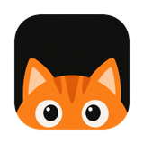
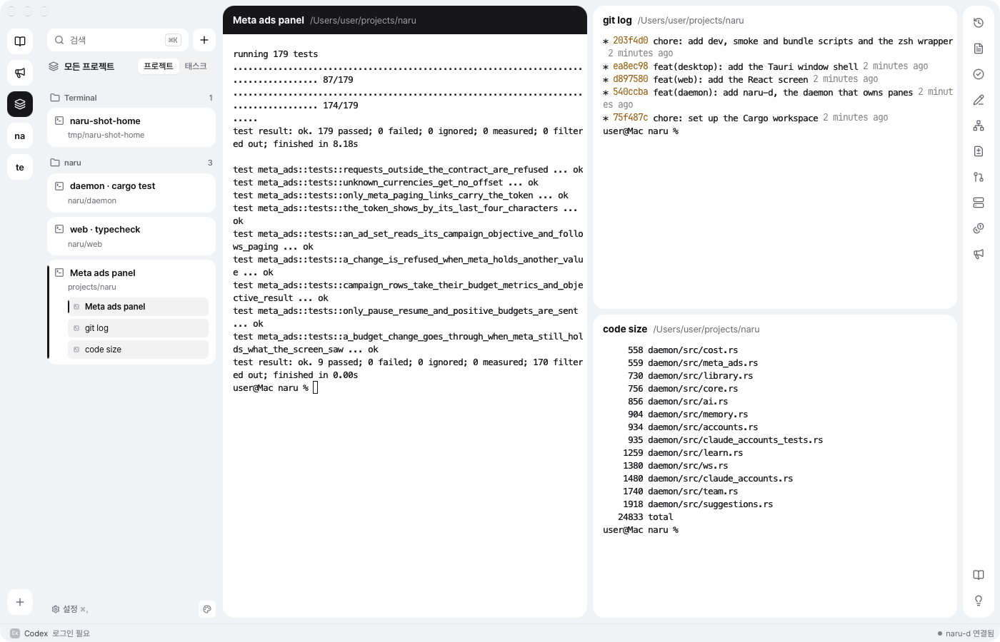

<p align="center">
  
</p>

<h1 align="center">Naru</h1>

<p align="center">
  <b>The terminal for working alongside CLI coding agents.</b><br>
  Claude Code, Codex, Grok and agy keep running in panes that outlive the window,<br>
  and Naru keeps track of which one needs you.
</p>

<p align="center">
  
</p>

---

## Why Naru

When you run several coding agents at once, the terminal becomes the bottleneck. Windows get closed while an agent is mid-turn. You lose track of which session asked a question ten minutes ago. Switching accounts when one hits its limit means logging out and in again.

Naru is a desktop terminal built around that workflow. A small daemon owns every pane, so closing the window never kills an agent. The screen on top of it groups sessions by project, tells you whose turn it is, and puts the tools you reach for between turns (PRs, dev servers, costs, notes) one click away.

## Features

### Sessions that survive the window

- **Panes live in a daemon.** `naru-d` holds every PTY. Quit the window with ⌘Q and your agents keep working. Open it again and everything is where you left it.
- **Resume after a restart.** After a reboot, Naru resumes each agent conversation in place. It starts the card you were looking at first, then the same project, three at a time, so thirty sessions don't freeze the machine.
- **Splits and tabs per project.** Projects on the left, sessions as cards, panes split right or down (⌘D / ⇧⌘D).

### Knows when an agent needs you

- **Turn tracking.** The sidebar marks sessions that are waiting on a question or permission, finished a turn, hit an error, or have a stuck child agent.
- **macOS notifications** for the same events, with an option to stay quiet while the window is in front.
- **Task view.** Switch the sidebar from projects to tasks and see what every agent is doing, summarized in one line.
- **Plans for child agents.** An agent can put a multi-step plan up for review. You approve it from the pane header, and each step's state (waiting, running, blocked, reported) follows its child agent.

### Agent accounts and limits

- **Accounts for Claude, Codex, Grok and agy.** Save several logins per agent and switch from the bottom bar. Refreshed tokens are written back before every switch, so none are lost.
- **Usage limits without spending tokens.** Limits are read from what the CLIs already write (Claude's statusline cache, Codex rollouts), not by calling a model.
- **Cost panel.** Shows the last seven days of spend per project at API prices, from the agents' own logs.

### Developer panels

- **Code map.** The focused pane's uncommitted changes drawn as file cards linked by imports. Click a card to open a floating code window with changed lines highlighted.
- **Pull requests.** Open PRs across every project's repository with their check states, pinned to the sessions working on their branches.
- **Dev servers.** Every port a program started from a pane is listening on, with a stop button.
- **Meta ads.** Campaigns, ad sets and ads with spend, impressions, clicks, CTR, CPC and results for today, yesterday, 7 or 30 days. Pause, resume or change a budget behind a before/after confirmation. Naru re-reads the value right before writing and refuses if it changed elsewhere, and every change is logged.

### Notes, reading and learning

- **Naru AI.** Suggestions and a Memory for each repository, built from your past sessions and handed back to agents through the `naru` CLI hook.
- **Brain.** One Obsidian note in a floating editor with live preview, like Obsidian's own. Text is saved exactly as typed, and an edit made in Obsidian in the meantime is never overwritten.
- **Library (서재).** A PDF shelf where each book gets its own Claude reading partner and a knowledge note in your vault.
- **Learning inbox (학습함).** Mark what was hard while you work, study it with an agent later, and keep a study note. A daily learning map groups your notes by topic.

### A terminal that stays out of the way

- ⌘F search in any pane, ⌘-click links and file paths, and a shortcut sheet on ⌘/.
- Terminal font and size apply to open panes immediately.
- Each part of the screen is isolated. If one panel breaks, the rest of the screen and your agents keep running.

## How it works

```
┌──────────────────────────┐        WebSocket (token + origin)        ┌──────────────────────────┐
│  Naru window (Tauri)     │ ◀──────────────────────────────────────▶ │  naru-d (Rust daemon)    │
│  React screen            │                                          │  PTYs, workspace state,  │
│  also runs in a browser  │                                          │  agents, panels, notes   │
└──────────────────────────┘                                          └────────────┬─────────────┘
                                                                                   │
                                          zsh wrapper (OSC 133/7) · agent CLIs · gh · Marketing API
```

| Part | Path | What it does |
| --- | --- | --- |
| Daemon | `daemon/` | `naru-d` owns panes and state and serves the screen at `ws://127.0.0.1:<port>/ws`. State lives in `~/Library/Application Support/Naru/`. |
| Screen | `web/` | React + xterm.js. The same screen runs in the Tauri window and in a plain browser through Vite. |
| Window | `desktop/src-tauri/` | Starts `naru-d` when it is not running and hands the screen its address. |
| Shell | `shell/zsh/` | A ZDOTDIR wrapper that reads your own zsh files first, then reports prompts and the working folder. |

## Getting started

Naru runs on macOS. You need Rust (the version is pinned in `rust-toolchain.toml`), Node and pnpm.

```bash
# Install screen dependencies
cd web && pnpm install && cd ..

# Build the app bundle: target/release/bundle/Naru.app
script/bundle
```

`script/bundle` signs with the first Apple Development identity in your keychain. Set `NARU_SIGN_IDENTITY` to pick another.

### Development

```bash
script/dev   # naru-d under a throwaway HOME + the screen in Vite
```

The development daemon always runs under a throwaway HOME, so it never touches the token and socket of the Naru you are using.

```bash
cargo test --workspace
cargo clippy --workspace --all-targets -- -D warnings
cargo fmt --all
cd web && pnpm typecheck
```

## Configuration

Everything is set from **Settings** (⌘,). The interface is in Korean.

| Setting | Where it is kept |
| --- | --- |
| Outside folders (Brain note, library notes, study notes) | `~/.naru/paths.json`. A feature whose folder is unset asks you to set it instead of guessing. |
| Meta system user token | `~/.naru/meta-ads.json`, readable only by you. The screen only ever sees its last four characters. |
| Agent accounts | `~/.naru/accounts/<agent>/` (Codex, Grok, agy) and the Claude account folder, all `0600`. |
| Screen, terminal font, notifications, bottom bar | Kept by the daemon so every window shares them. |

## Security

- The screen's WebSocket checks both a per-install token and the page origin.
- Tokens and saved logins are written with owner-only permissions and never sent to the screen.
- Agent session variables are removed from pane environments, so agents started in Naru behave like ones you start yourself.
- Session IDs and launchers are checked before they go on a command line. Nothing is run from a guess.

## Status

Naru is being rebuilt on Tauri + React + Rust from an earlier fork, and it is the terminal its author uses every day. Expect rough edges and Korean-only text in the interface.
